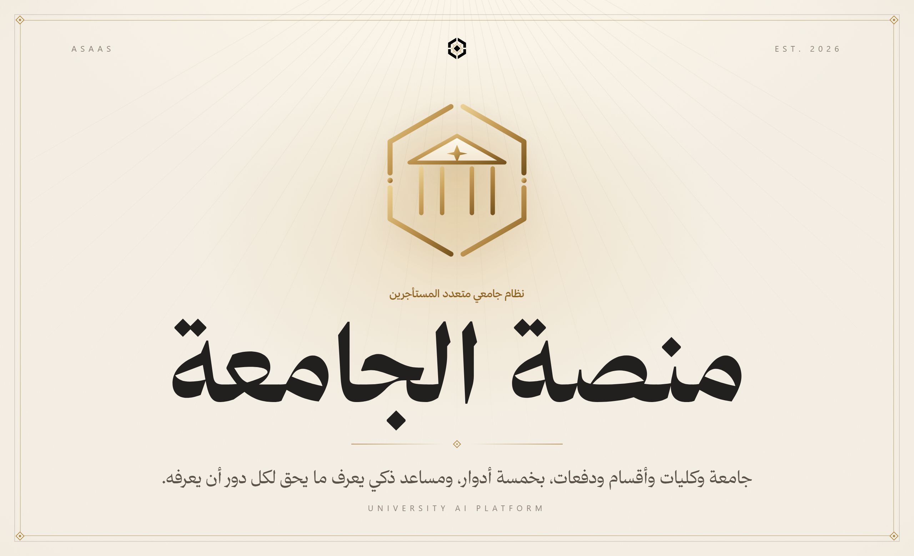
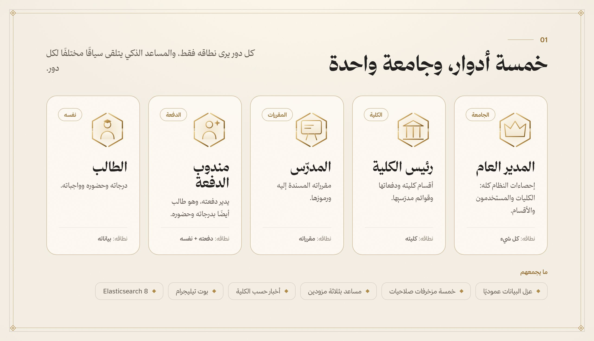
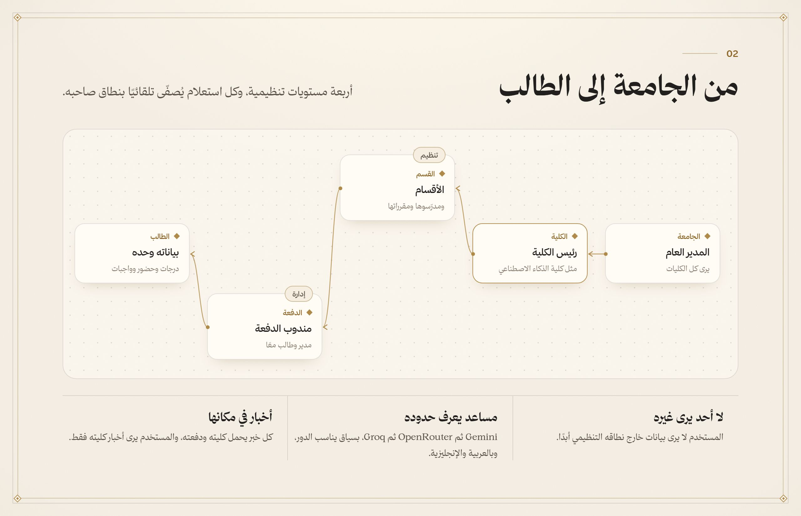
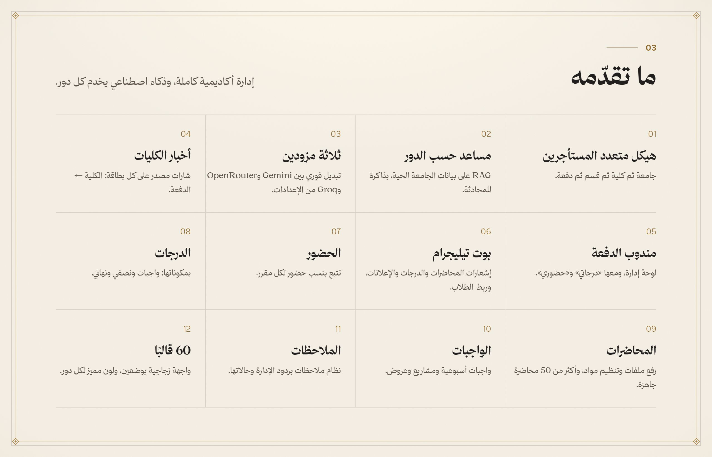
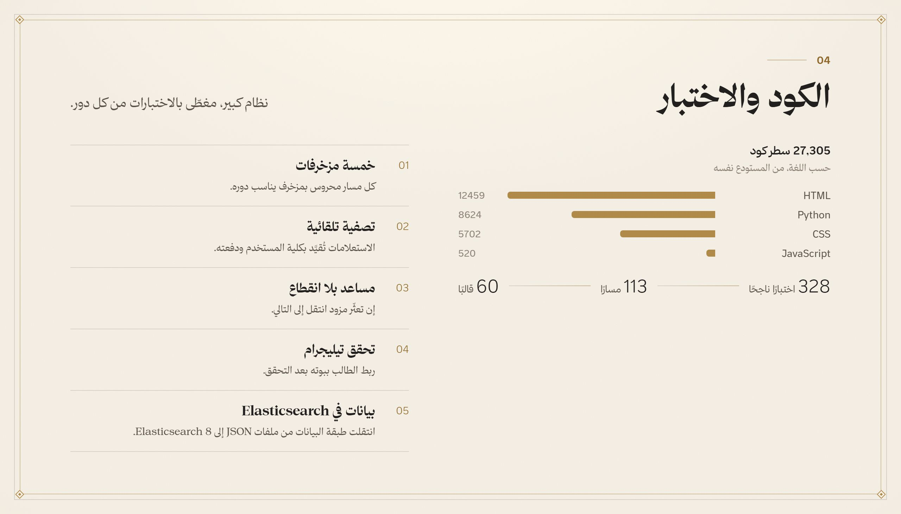
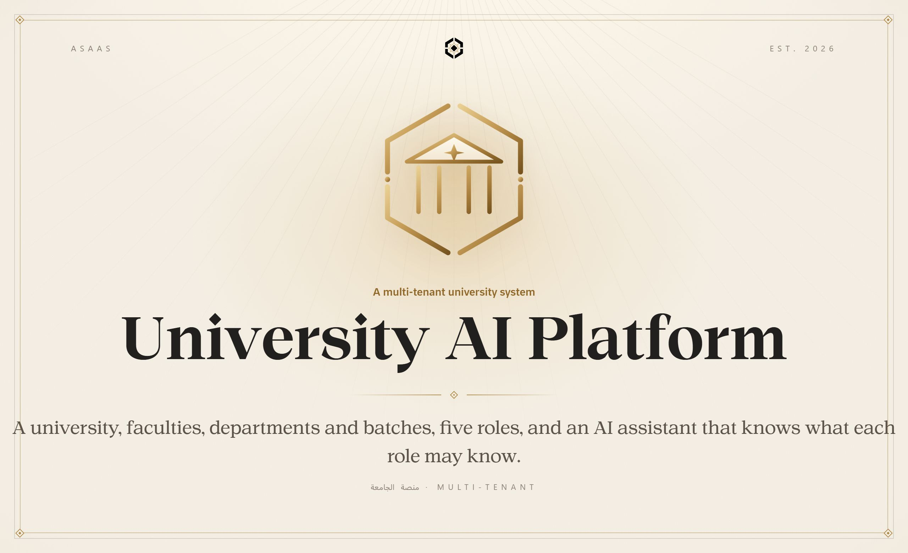
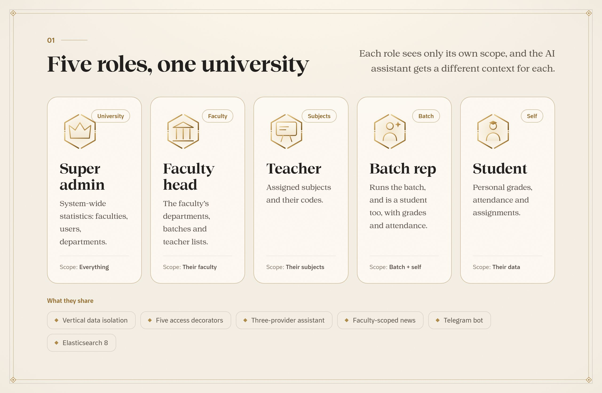
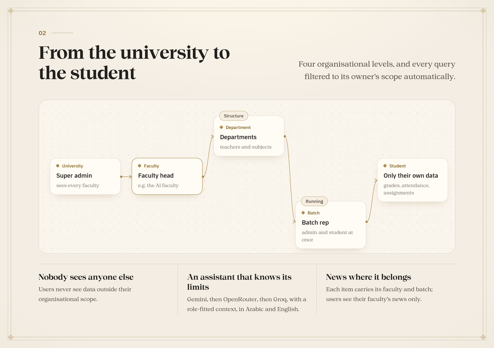
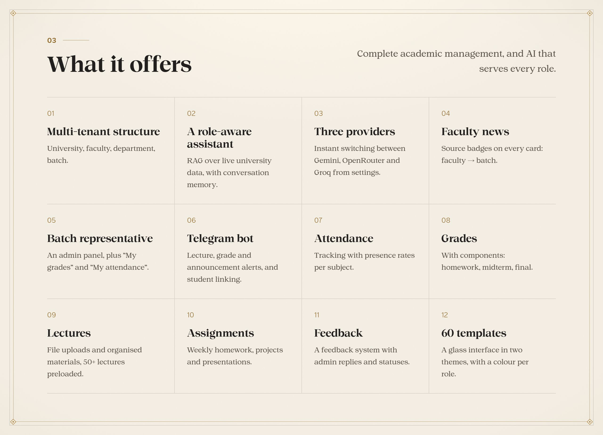
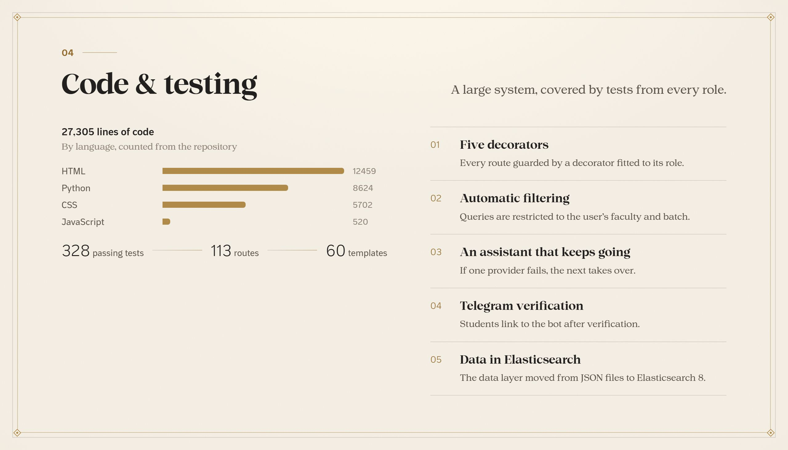

<b>العربية</b> · <a href="#english">English</a>

 

نظام إدارة جامعية متعدد المستأجرين: جامعة وكليات وأقسام ودفعات، بخمسة أدوار لكل منها نطاقه، ومساعد ذكي يتلقى سياقًا مختلفًا لكل دور ويتنقل بين Gemini وOpenRouter وGroq، وأخبار مقيّدة بالكلية، وبوت تيليجرام للإشعارات، وحضور ودرجات ومحاضرات وواجبات. ويقف على Flask وElasticsearch 8، ومغطّى بـ 328 اختبارًا.

 

<b>الكود في مستودع خاص</b> هذه واجهة العرض العامة لـ«منصة الجامعة». الكود المصدري محفوظ في مستودع خاص، والمساهمة فيه متاحة بدعوة. <a href="https://alaadin-alynaey.site/">تواصل لطلب الوصول أو المساهمة</a>

 

<a href="#arabic">العربية</a> · <b>English</b>

 

A multi-tenant university management system: a university, faculties, departments and batches, five roles each with its own scope, an AI assistant that gets a different context per role and fails over between Gemini, OpenRouter and Groq, faculty-scoped news, a Telegram bot for notifications, and attendance, grades, lectures and assignments. Built on Flask and Elasticsearch 8, and covered by 328 tests.

 

<b>The source lives in a private repository</b> This is the public showcase of University AI Platform. The source code is kept private, and contributions are open by invitation. <a href="https://alaadin-alynaey.site/">Get in touch for access or to contribute</a>

 

  جزء من منظومة <b>أساس</b> · Part of the <b>Asaas</b> ecosystem
   
  من تصميم وبناء <a href="https://github.com/AladdinAlynaey">علاء الدين اليناعي</a> · Designed and built by <a href="https://github.com/AladdinAlynaey">Alaadin Alynaey</a>
   
  © 2026 · جميع الحقوق محفوظة · All rights reserved

